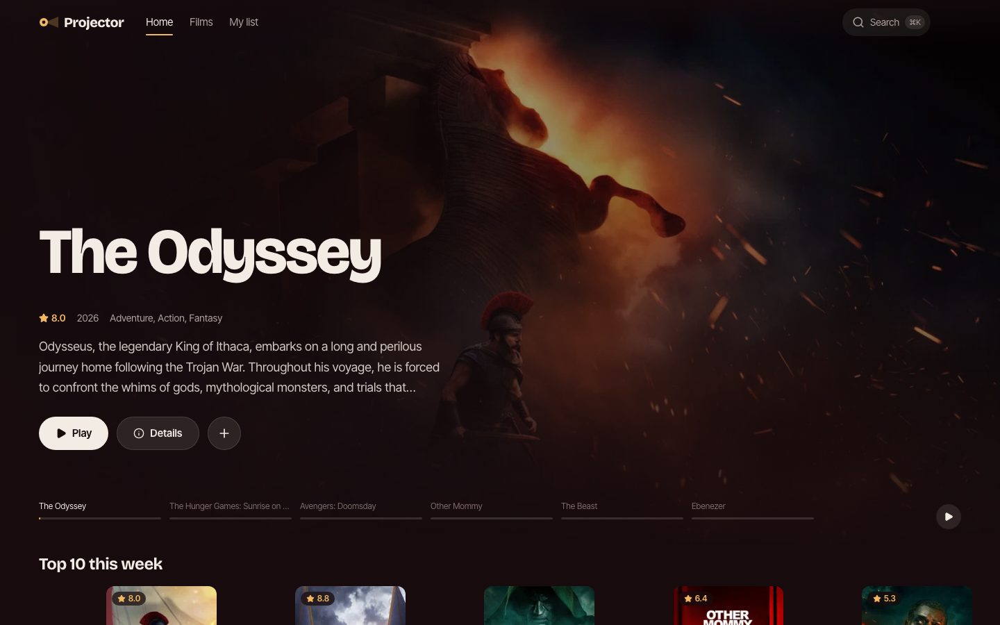
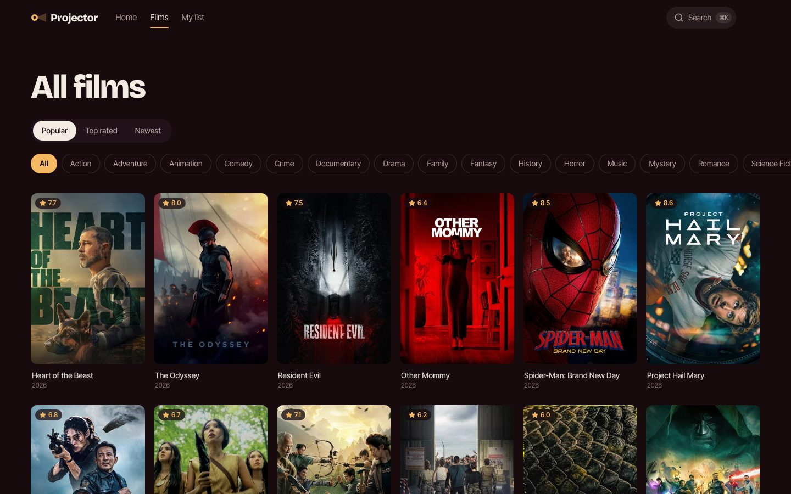
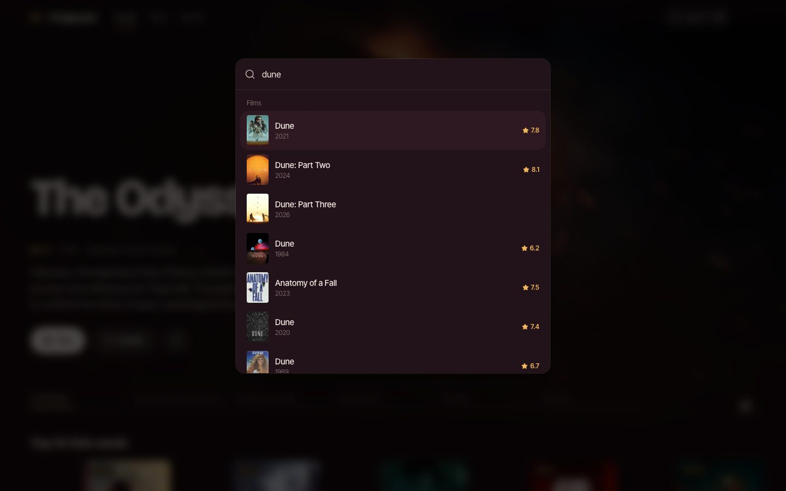
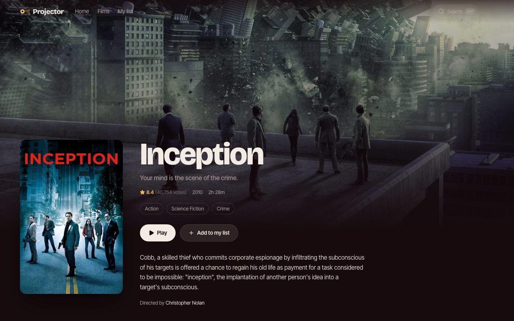
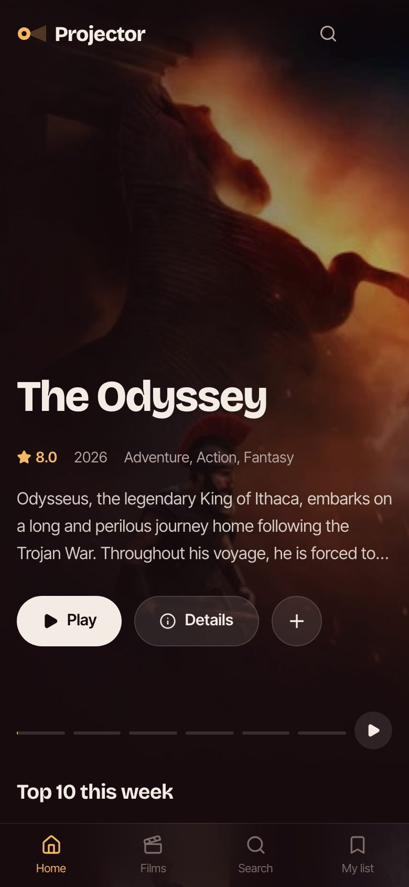

<p align="center">
  
</p>

<h1 align="center">Projector</h1>

<p align="center">
  <b>Find something good to watch tonight.</b><br />
  This week's most-watched films, all-time favourites and a list of your own, in one place.
</p>

<p align="center">
  <a href="#run-it-on-your-computer">Run it</a> ·
  <a href="#put-it-online-with-vercel">Deploy</a> ·
  <a href="#features">Features</a>
</p>

<p align="center">
  
</p>

## Features

**🎬 Featured films.** The home page opens like a cinema: a line of projector light, then the shutter opens onto this week's biggest film. It changes every few seconds. Swipe, use the arrow keys or press pause.

**🍿 Rows to browse.** Top 10 this week, Popular right now, In cinemas, Coming soon and All-time favourites.

**🔎 Search anything.** Press <kbd>⌘K</kbd>, <kbd>Ctrl K</kbd> or <kbd>/</kbd> from any page and start typing.

**🎞️ Every film, sorted your way.** Filter by genre, sort by popular, top rated or newest. More films load as you scroll.

**📽️ A page for every film.** Rating, runtime, genres, director, cast, a Play button and similar films. Click any poster for a quick details popup.

**🔖 My list.** Save films with one click and find them later.

**📱 Made for phones too.** Tab bar at the bottom, works around the notch, nothing scrolls sideways.

**🔒 Your own account.** Sign up free with Clerk. Every page needs an account.

## Screenshots

| Browse all films | Search |
|---|---|
|  |  |

| Film page | On a phone |
|---|---|
|  |  |

## Run it on your computer

You need [Node.js](https://nodejs.org) 20 or newer.

1. Install the packages:

   ```bash
   npm install
   ```

2. Make your settings file:

   ```bash
   cp .env.example .env
   ```

3. Open `.env` and add your two keys:

   | Key | Where to find it |
   |---|---|
   | `VITE_CLERK_PUBLISHABLE_KEY` | [Clerk dashboard](https://dashboard.clerk.com) → API keys |
   | `TMDB_TOKEN` | [TMDB](https://www.themoviedb.org/settings/api) → Settings → API → **API Read Access Token** |

   `TMDB_TOKEN` stays on the server: the site asks `/api/tmdb`, which adds the token, so visitors never see it.

   Never put real keys in `.env.example`. Git saves that file; it ignores `.env`.

4. Start it:

   ```bash
   npm run dev
   ```

   Open http://localhost:3000.

| Command | What it does |
|---|---|
| `npm run dev` | Starts the site on your computer |
| `npm run build` | Builds the site for production |
| `npm test` | Runs the tests |

## Put it online with Vercel

1. Sign in to [Vercel](https://vercel.com) with GitHub.
2. Click **Add New → Project** and import this repo. Vercel finds the settings by itself.
3. Under **Environment Variables**, add:
   - `TMDB_TOKEN` as a **Secret**
   - `VITE_CLERK_PUBLISHABLE_KEY` as **Config** (this key is meant to be public)
4. Click **Deploy**.

Every push to `main` updates the live site. `vercel.json` makes sure links like `/movie/27205` work when you refresh, and sends `/api/tmdb/...` to the TMDB function in `api/tmdb.ts`.

For a real launch, use a production instance in Clerk (its key starts with `pk_live_`) and add your site's address there.

## Pages

| Address | Page |
|---|---|
| `/` | Home |
| `/movies` | All films, with genre and sort |
| `/movie/:id` | One film |
| `/list` | My list |

## Built with

[React 19](https://react.dev) · [Vite](https://vite.dev) · TypeScript · [TanStack Router & Query](https://tanstack.com) · [Tailwind CSS 4](https://tailwindcss.com) · [Clerk](https://clerk.com) · [TMDB API](https://developer.themoviedb.org)

- Pages live in `src/routes/`.
- All TMDB requests are in `src/lib/tmdb.ts`, and go through `api/tmdb.ts`.
- Colours, fonts and animations are in `src/styles.css`.

## Credits

Film data and images come from [TMDB](https://www.themoviedb.org). This product uses the TMDB API but is not endorsed or certified by TMDB.
